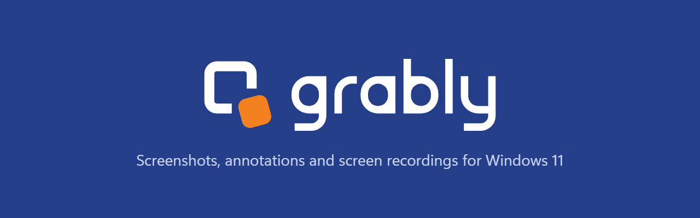
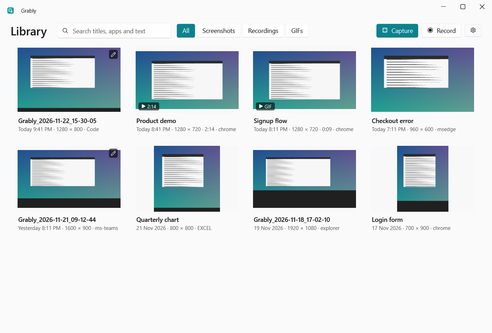
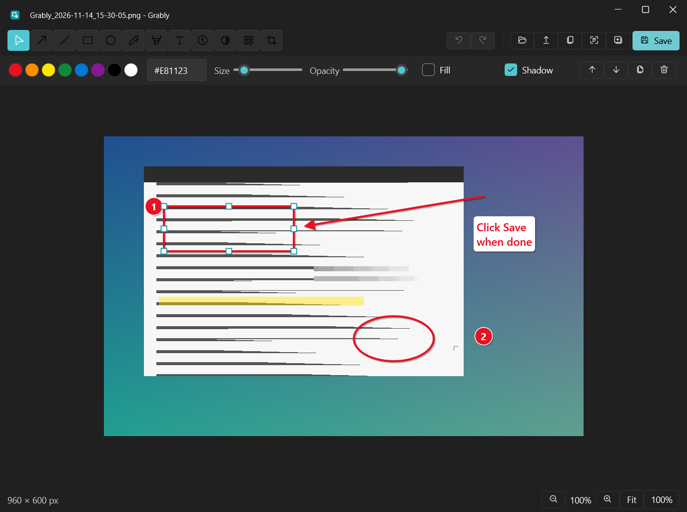
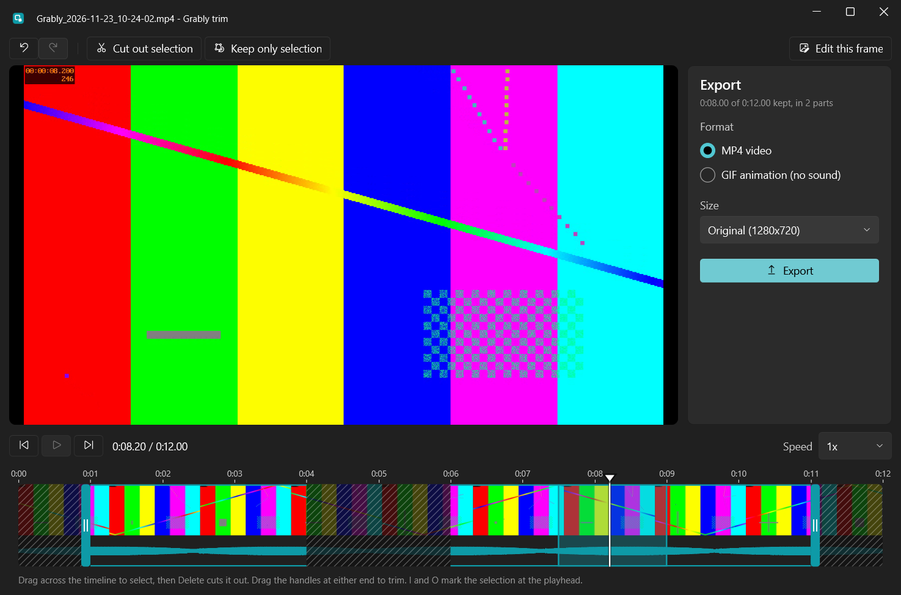

<p align="center">
  
</p>

# Grably

Free, open-source screenshots, annotations and screen recordings for Windows 11.

- **Capture:** a region, a window, the whole screen, or a scrolling page. Copy the text in any part of the screen.
- **Annotate:** arrows, shapes, text, numbered steps, highlights, blur and pixelate. Annotations stay editable in the library.
- **Record:** the screen with the PC's sound and your microphone, the webcam in a bubble, the pointer, clicks and shortcuts.
- **Trim and share:** cut a recording down and export it as MP4 or GIF.

<p align="center">
  
</p>

| Annotate a screenshot | Trim a recording |
|---|---|
|  |  |

Grably is in early development. The plan and progress are in [docs/PLAN.md](docs/PLAN.md).

## Install

Download `SBLAdvisory.Grably-win-Setup.exe` from the [latest release](https://github.com/SBL-Advisory/grably/releases/latest) and run it.

- Grably installs for your Windows account only, so no administrator rights are needed. It adds itself to the Start menu and starts in the notification area.
- **The installer is not code-signed yet,** so Windows SmartScreen may say "Windows protected your PC". Choose **More info**, then **Run anyway**.
- **Updates:** Grably checks for updates in the background (you can turn this off in Settings). It downloads a new version quietly, then installs it when you choose **Restart to update** in the tray menu, or the next time Grably starts.
- **Uninstall:** use **Settings > Apps > Installed apps**. Your captures, recordings and library stay where they are: `Pictures\Grably`, `Videos\Grably` and `%LocalAppData%\Grably`.

Requires Windows 11 (64-bit).

## Building

Requires Windows 11 and the .NET 10 SDK.

```
dotnet build Grably.slnx
dotnet test --solution Grably.slnx --filter-not-trait "Category=Desktop"
```

Run `src/Grably.App/bin/Debug/net10.0-windows10.0.26100.0/Grably.exe`. Grably starts in the notification area; click its icon to open the Library.

Recording and exporting need ffmpeg in `src/Grably.App/ffmpeg` (git ignores it). There are two ways to get it:

- `powershell -File tools/ffmpeg/build.ps1` builds Grably's own minimal LGPL ffmpeg in Docker. This is what ships.
- `powershell -File tools/fetch-ffmpeg.ps1` downloads a larger ready-made build. It is quicker and needs no Docker, but it is for development only.

### Packaging and releases

- `powershell -File build/pack.ps1` makes the installer and update packages in `artifacts/releases` with [Velopack](https://velopack.io).
- Pushing a tag `v<version>` that matches `<Version>` in `Directory.Build.props` runs `.github/workflows/release.yml`. It builds ffmpeg, tests, packs, and publishes a GitHub release with the FFmpeg source attached.

## License

[MIT](LICENSE). Grably ships FFmpeg (LGPL) and other open-source components; see [THIRD-PARTY-NOTICES.md](THIRD-PARTY-NOTICES.md).
