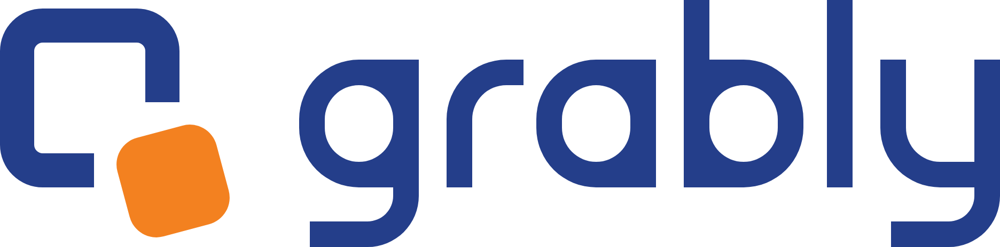

# Grably brand assets

The Grably mark is a rounded screen frame with a piece lifted out of its corner: grabbing part of the screen. While Grably is recording, the lifted piece becomes a red record dot. Grably is built by Strategies Beyond Limits (SBL), and its colours are SBL's: navy and orange.



Every file here except `sbl/` (see below) is generated by [`tools/brand/build_brand.py`](../../tools/brand/build_brand.py). Change the geometry or colours there and re-run it instead of editing the files by hand:

```
python tools/brand/build_brand.py
```

It needs Python 3.10+, Pillow and Microsoft Edge or Google Chrome (used headless to rasterise the SVGs).

## Files

| File | Use |
|---|---|
| `grably-symbol.svg` | Master symbol in colour, for light backgrounds, 24 px and up |
| `grably-symbol-on-dark.svg` | Symbol for dark backgrounds (white frame, orange piece) |
| `grably-symbol-black.svg`, `grably-symbol-white.svg` | One-colour symbol |
| `grably-symbol-small.svg` | Small cut for 16 and 20 px: thicker grid-fitted frame, piece not tilted |
| `grably-symbol-recording.svg` | Recording state: the piece replaced by the red dot |
| `grably-wordmark.svg` | Custom-drawn `grably` wordmark (outlined paths, no font needed) |
| `grably-lockup.svg` / `.png` | Symbol + wordmark for light backgrounds |
| `grably-lockup-on-dark.svg` / `.png` | Symbol + wordmark for dark backgrounds |
| `grably-lockup-black.svg`, `grably-lockup-white.svg` | One-colour lockups |
| `grably-app-icon.svg`, `grably-app-icon-small.svg` | App icon (navy tile, white frame, orange piece), large and 16 to 20 px cut |
| `grably.ico` | Exe and window icon: 16, 20, 24, 32, 40, 48, 64 and 256 px |
| `tray/tray-idle-light.ico`, `tray/tray-recording-light.ico` | Tray icons for a light taskbar (navy frame) |
| `tray/tray-idle-dark.ico`, `tray/tray-recording-dark.ico` | Tray icons for a dark taskbar (white frame) |
| `grably-banner.png` | README banner, 1280 x 400 |
| `grably-symbol-512.png`, `grably-symbol-on-dark-512.png`, `grably-app-icon-512.png` | Raster previews |

Each `.ico` holds frames drawn for their exact size; the 16 and 20 px frames use the small cut. Tray `.ico` files hold 16, 20, 24, 32, 40 and 48 px (100 % to 300 % display scaling).

**Picking the tray icon in the app:** read `SystemUsesLightTheme` under `HKCU\Software\Microsoft\Windows\CurrentVersion\Themes\Personalize` (1 = light taskbar, 0 or missing = dark), use the matching `-light` or `-dark` file, and switch again when Windows broadcasts `WM_SETTINGCHANGE` with `ImmersiveColorSet`.

## Colours

| Name | Hex | RGB | Use |
|---|---|---|---|
| SBL navy | `#243E8A` | 36, 62, 138 | Frame and wordmark on light backgrounds, app icon tile, banner background, UI accent fills in the light theme (9.9:1 on white) |
| Navy dark | `#1D3371` | 29, 51, 113 | Accent text and links on light backgrounds (12:1 on white) |
| Navy mid | `#5B78D0` | 91, 120, 208 | Right-click rings in recordings, and the dark theme's darker accent shade (shows on light and dark content: 4.2:1 on white, 3.9:1 on #202020) |
| Navy light | `#8FA6E8` | 143, 166, 232 | UI accent fills (with black text), accent text and links on dark backgrounds (6.8:1 on #202020) |
| SBL orange | `#F38120` | 243, 129, 32 | The lifted piece, and marks Grably draws over screenshots and video: selection outlines, handles, the trim selection, left-click rings. Graphics only, never text (2.6:1 on white) |
| Recording red | `#E5383B` | 229, 56, 59 | Recording state only (the record dot, recording indicators). Never decoration |
| White | `#FFFFFF` | 255, 255, 255 | Frame and wordmark on dark backgrounds, mark on the app tile |

## Rules

- **Clear space:** keep empty space on every side of at least twice the frame's stroke width (about a third of the symbol's height).
- **Minimum sizes:** symbol 16 px (use the small cut at 16 and 20 px), lockup 24 px tall.
- **Recording red means recording.** Use it only when Grably is actually recording. SBL orange sits close to it, so keep orange for the idle piece and marks, and never for a recording state.
- **The tilt is part of the mark.** Do not straighten the piece in the master, and do not tilt it further.
- Use the colour versions only on white, near-white or SBL navy; on photos or mid-tone backgrounds use the one-colour white or black version.
- Do not stretch, outline, add shadows or gradients, recolour parts outside the variants above, or rearrange the symbol and wordmark.

## Typography

The wordmark is custom geometry, not a font: stem 24, x-height 120, rounded-square bowls (outer radius 56), a crop-corner `r`, and one shared hook for `g` and `y`. The banner tagline is set in Segoe UI Variable, rendered into the PNG only.

## SBL logos

`sbl/` holds the Strategies Beyond Limits logos for the "Built By" credit in Settings. They are SBL's own files, copied as they are, not generated: never redraw, recolour or edit them.

| File | Use |
|---|---|
| `sbl/sbl-logo-color.png` | Full-colour logo, for light backgrounds |
| `sbl/sbl-logo-white.png` | Cream wordmark with the orange arrow, for dark backgrounds |

The app picks one by theme (`ThemeController.SblLogoKey`).
